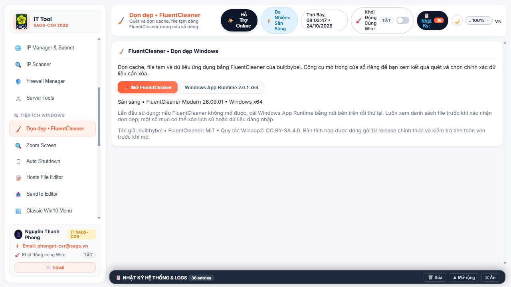

# QA Windows — IT Tool / SAGS-CXR 2026 — 1.0.2

Ngày kiểm tra: 24/10/2026. Thực hiện trên Windows thật trong workspace dự án.

## Kết quả và phạm vi

| Lớp kiểm tra | Kết quả | Giới hạn |
|---|---|---|
| Hợp đồng giao diện/API | 215 phương thức; không trùng tên, không gọi API thiếu, không thiếu handler/script/section, không trùng HTML ID | Phân tích tĩnh, không chứng minh mọi nhánh lệnh đúng |
| Điều hướng giao diện | 29/29 tab hiển thị, không ghi nhận console error | Trình duyệt replay phản hồi đọc từ Windows; mọi thao tác ghi bị chặn. Không phải kiểm thử tất cả nút trong WebView thật |
| API đọc trên Windows | 42/44 PASS | AD chưa có domain/RSAT. iSCSI thử lại quyền admin: Microsoft iSCSI Initiator Service chưa chạy |
| Kiểm thử Python | 36/36 PASS | Gồm bảo mật, FluentCleaner và 22 ca hồi quy chức năng; các thao tác ghi hệ thống dùng mock |
| JavaScript | Kiểm tra cú pháp tất cả file JS đạt; test renderer mạng đạt | Không thay thế kiểm tra thiết bị thực |
| EXE 1.0.2 | 31/31 kiểm tra runtime đạt, exit code 0 | Nạp module, WinForms, `_tkinter`, tạo và hủy cửa sổ Tk ẩn; chưa bấm toàn bộ chức năng trên EXE |

## Lỗi đã sửa

1. Hàm `runModule` bị ghi đè, gọi nhầm API `run_module`. Gộp về `run_tool_module`, giữ nhánh Server Tools.
2. `get_app_info` khai báo hai lần làm mất `is_admin`. Giữ một định nghĩa có đủ metadata.
3. Dispatcher cũ chạy nhánh mặc định nguy hiểm hoặc báo thành công dù không làm gì. Chỉ chấp nhận cặp module/action rõ ràng; BitLocker yêu cầu ổ đĩa cụ thể; chuyển tiếp kết quả API chính.
4. IP Manager thiếu kiểm tra mode/IP/mask/gateway/DNS, dựng lệnh shell và bỏ qua lỗi DNS. Dùng argument list, kiểm tra toàn bộ đầu vào trước lệnh đầu tiên, kiểm tra từng return code, báo thay đổi một phần khi DNS lỗi.
5. Subnet /31 và /32 trả sai usable hosts. Sửa thành 2 và 1, kiểm tra thêm /0, /24 và đầu vào lỗi.
6. IPv6 coi lỗi truy vấn như trạng thái tắt, báo thành công khi lệnh thay đổi lỗi. Kiểm tra mã thoát, dữ liệu và trạng thái sau thao tác.
7. BitLocker dựa từ khóa trong thông báo lỗi để báo thành công. Dùng return code, bật PowerShell Stop, kiểm tra tên ổ đĩa ở thao tác ghi và lấy key.
8. Lấy Recovery Key tự thêm protector khi không tìm thấy key. Loại bỏ thao tác tạo; hàm chỉ đọc key hiện có.
9. Hibernate thực hiện Sleep. Sửa immediate/quick timer sang `shutdown /h`; báo lỗi khi lệnh nguồn thất bại.
10. Hẹn giờ nhận NaN/vô cực, action sai rơi về shutdown, thông số lịch/tên task không kiểm tra. Thêm kiểm tra action, thời gian, tần suất, ngày và tên task thuộc ứng dụng; PowerShell lỗi dừng rõ ràng.
11. StartupApproved ghi sai khóa cho Startup Folder/WOW64. Dùng đúng StartupFolder/Run32 và đọc lại trạng thái folder; RunOnce trả không hỗ trợ bật/tắt thay vì báo thành công giả.
12. Startup editor xóa mục cũ trước khi lưu mục mới, escape PowerShell sai, nhánh nâng quyền báo thành công khi chưa xác minh. Lưu thành công trước khi xóa cũ, quote literal shortcut, trả lỗi quyền thực; giới hạn đường dẫn xóa trong thư mục Startup đã chọn.
13. iSCSI bỏ qua return code. Trả lỗi thật khi thiếu quyền/dịch vụ chưa chạy.
14. Uninstall Manager tiếp tục xóa Registry/thư mục dù native hoặc Store uninstaller lỗi/hủy. Dừng trước bước dọn khi chưa xác nhận thành công; không giết trình gỡ chỉ vì hết thời gian chờ; kiểm thử mã hủy MSI 1602, lỗi và nhánh thành công.

## Các mục chưa thể xác nhận đầu cuối trên máy hiện tại

- Active Directory cần domain/RSAT; NIC Teaming, DHCP và iSCSI cần môi trường Windows Server/thiết bị đích phù hợp. Không bật dịch vụ hoặc cấu hình máy chỉ để vượt kiểm thử.
- Đổi IP/DNS/IPv6, bật/tắt firewall, BitLocker/EFS, Windows Update, boot/partition, shutdown/restart và sửa Registry được kiểm tra tĩnh và/hoặc mock ở các nhánh nêu trên. Chưa thực hiện thay đổi thật cho tất cả chức năng.
- Cài/gỡ ứng dụng thật, Office/winget, khôi phục backup, dọn dữ liệu, sửa máy in và clean bản quyền cần máy Windows/VM dùng thử với snapshot và dữ liệu mẫu. Chưa chạy các thao tác phá hủy trên máy đang sử dụng.
- Camera, microphone, loa, bàn phím, màn hình, pin và in trang test cần thiết bị thật và xác nhận kết quả vật lý. Chưa xác nhận chất lượng phần cứng.
- Không tuyên bố toàn bộ chức năng đã đạt kiểm thử đầu cuối. Kết quả PASS chỉ áp dụng đúng lớp và phạm vi trong bảng.

## Bản phân phối

- EXE: `dist/qa-tested/IT_Tool_SAGS_CXR_2026.exe`.
- Bản sao cùng hash: `dist/IT_Tool_SAGS_CXR_2026.exe`, `dist/integrated/IT_Tool_SAGS_CXR_2026.exe`.
- Shortcut `IT Tool SAGS-CXR 2026.lnk` trỏ tới bản qa-tested 1.0.2.
- Bản 1.0.1 trong `dist/tk-fix` có thể vẫn đang chạy; thoát ứng dụng cũ từ khay hệ thống rồi mở shortcut. Không ép dừng phiên đang sử dụng.
- SHA-256: `AE79E3AD35BBA3F9991063A358E243DA5F6760241F1B876975C3E22A7087C241`.

## Bằng chứng

- `qa-static.json`: hợp đồng tĩnh sau sửa.
- `qa-ui.json`: kết quả điều hướng 29 tab và console errors trong replay.
- `qa-windows.json`: 44 API đọc; kèm kết quả iSCSI chạy lại quyền Administrator.
- `runtime-frozen-qa.json`: tự kiểm tra EXE cuối cùng, 31 checks.
- `qa-regressions.log`, `build-qa.log`: kết quả unittest và đóng gói.
- Dữ liệu thô máy chỉ lưu ở `ITTools/scratch/qa-results` đã bỏ qua Git, không đưa vào báo cáo.

